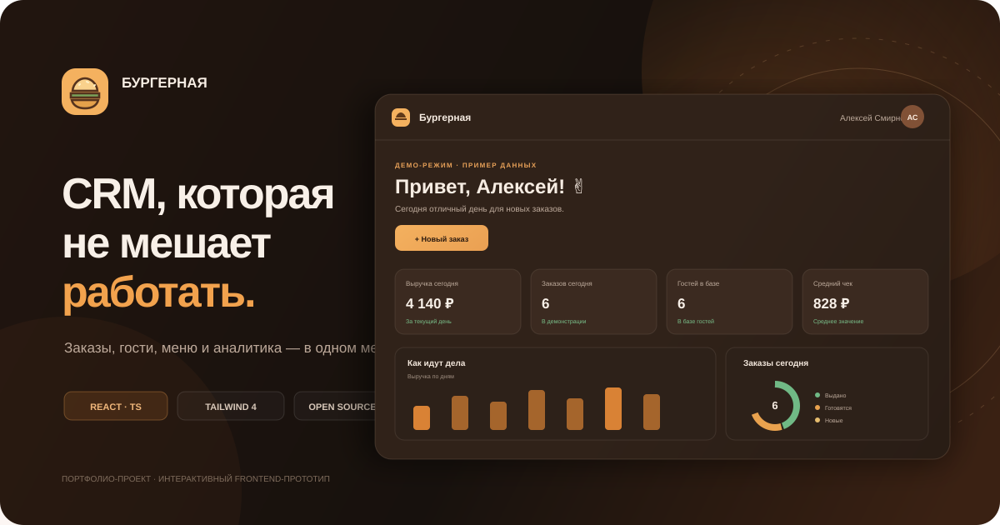

# 🍔 Burger CRM

**A warm, lightweight CRM concept for a small burger restaurant.** Orders, guests, menu items, promotions, and analytics in one calm workspace.



> A portfolio frontend prototype with fictional demo data. It is not connected to a POS, delivery provider, payment service, or server-side database.

See [docs/ARCHITECTURE.md](./docs/ARCHITECTURE.md) for architecture notes and limitations. A short portfolio walkthrough is available in [docs/DEMO-GUIDE.md](./docs/DEMO-GUIDE.md).

## Features

- **Dashboard:** daily revenue and orders, average check, order status overview, recent orders, and tasks.
- **Orders:** create orders, search, filter, update statuses, and export CSV.
- **Customers:** guest profiles, contact details, notes, order history, and CSV export.
- **Menu:** categories, prices, descriptions, create/edit/delete actions, and availability toggles.
- **Analytics:** order history metrics, revenue chart for a selected period, and item distribution by category.
- **Promotions:** create offers and enable or pause them.
- **Settings:** dark/light themes, JSON backup, and demo-data reset.
- **Usability:** responsive layout, section search, `Ctrl/⌘ + K`, notifications, and toast feedback.

## Stack

- React 19 and TypeScript 5
- Vite 6
- Tailwind CSS 4 with custom CSS variables
- Lucide React
- Browser `localStorage` for demo persistence

## Requirements

- Node.js 20 or newer
- npm

## Run locally

### Windows

1. Download or clone this repository.
2. Open the project folder.
3. Double-click `run.bat`, or run:

```bash
npm install
npm run dev
```

4. Open `http://localhost:5173`.

### macOS / Linux

```bash
chmod +x run.sh
./run.sh
```

Or run `npm install` followed by `npm run dev` manually.

## Scripts

| Command | Description |
| --- | --- |
| `npm run dev` | Start the development server |
| `npm run typecheck` | Run TypeScript checks |
| `npm run build` | Create a production build in `dist/` |
| `npm run preview` | Preview the production build locally |

## Deploy to GitHub Pages

A deployment workflow is included at `.github/workflows/deploy.yml`.

1. Create a public repository, for example `burger-crm`.
2. Push the project to the `main` branch.
3. Open **Settings → Pages → Build and deployment**.
4. Select **GitHub Actions** as the source.
5. On each push, the workflow checks types, builds the app, and deploys `dist/`.

Example commands for the first push:

```bash
git init
git add .
git commit -m "Initial Burger CRM prototype"
git branch -M main
git remote add origin https://github.com/YOUR-USERNAME/burger-crm.git
git push -u origin main
```

## Data and security

- All names, phone numbers, email addresses, and metrics are fictional. Do not add real guest data to this demo project.
- Changes are stored in the current browser's `localStorage`; they are not synchronized across browsers or devices.
- Stored data is validated on startup. Invalid or outdated data falls back to the demo dataset.
- If browser storage is blocked, the app remains usable in the current tab and warns that changes will not survive closing it.
- CSV exports are protected against spreadsheet formula injection from user-controlled values.
- The repository contains no API keys, passwords, or production database URLs. `.env.example` only contains public UI configuration.

## Scope and limitations

This is a single-user frontend prototype, not a production CRM. It has no backend or database, authentication or employee roles, synchronization, POS/delivery integrations, or analytics from actual payment data. Some chart decorations remain illustrative.

## Roadmap

- Backend API and database migrations.
- Authentication, staff roles, and an audit log.
- Full order editor with multiple line items and status history.
- Inventory and cost management.
- Analytics for sales channels and repeat purchases.
- POS and delivery integrations.

## License

Released under the [MIT License](./LICENSE).

For the Russian overview, see [README.md](./README.md).
